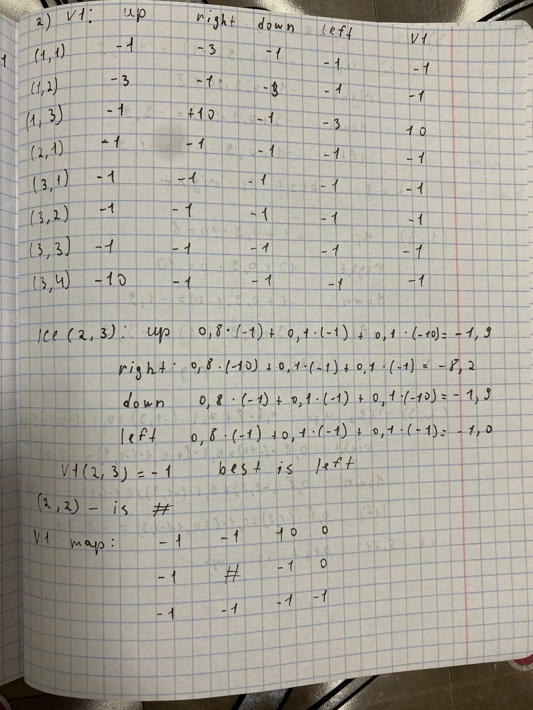

# HW6 submission

## AI-use declaration

I used Claude (AI assistant) to explain the method, to help with the Part A calculations (I copied them by hand into my notebook), to choose the fixed policy, and to write and run the code for Part B and Part C (`part_b.py`, `gridmdp.py`, `solver.py`, `simulate.py`, `part_c.py`, `checks.py`).

## Setup and reproduction

Versions: Python 3.12.2, gymnasium 1.4.0, numpy 2.5.5 (see `requirements.txt` and `outputs/versions.txt`).

```
python -m venv .venv
.venv\Scripts\activate
pip install -r requirements.txt
python part_b.py
python part_c.py
python checks.py
```

Part C reads the floor rules and maps from `data/maps.json`. All runs use fixed seeds, so the results are the same every time.

## Part A — Paper calculations

My notes:





**V1** (V0 = 0, gamma = 0.9). G and H have value 0.

| | col 1 | col 2 | col 3 | col 4 |
| --- | --- | --- | --- | --- |
| row 1 | -1 | -1 | 10 | G (0) |
| row 2 | -1 | wall | -1 | H (0) |
| row 3 | -1 | -1 | -1 | -1 |

Ice tile (2,3), V1 for each action: up -1.9, right -8.2, down -1.9, left -1.0. So V1 = -1.

**V2** (uses only V1):

| Tile | up | right | down | left | V2 |
| --- | --- | --- | --- | --- | --- |
| (1,2) | -3.9 | 8 | -3.9 | -1.9 | 8 |
| (1,3) | 8 | 10 | -1.9 | -3.9 | 10 |
| (2,3) ice | 5.21 | -7.39 | -2.71 | -0.91 | 5.21 |

**Best actions:** (1,2) right, (1,3) right, (2,3) up. No ties.

**Why two rounds are not enough:** Two rounds look only two moves ahead. Far tiles like (3,1) still have V = -1, because the reward of G has not reached them yet. Their values and best actions can change later, so we must continue until the values stop changing.

## Part B — FrozenLake

### Fixed policy, written before the experiments

Actions for the nonterminal states (state: action): 0: right, 1: right, 2: down, 3: left, 4: down, 6: down, 8: right, 9: right, 10: down, 13: right, 14: right.

Reasoning: I made a safe path from the start to the goal without slipping: 0, 1, 2, 6, 10, 14, 15. The other states go back to this path or toward the goal and never directly into a hole. The policy does not change between experiments.

### Results

| Slippery? | Policy | Batch seed | Goals /50 | Holes /50 | Time limits /50 | Success % | Mean steps |
| --- | --- | --- | --- | --- | --- | --- | --- |
| False | random | 11 | 0 | 50 | 0 | 0.0 | 7.98 |
| False | random | 22 | 0 | 50 | 0 | 0.0 | 6.42 |
| False | random | 33 | 1 | 49 | 0 | 2.0 | 6.66 |
| False | fixed | 11 | 50 | 0 | 0 | 100.0 | 6.0 |
| False | fixed | 22 | 50 | 0 | 0 | 100.0 | 6.0 |
| False | fixed | 33 | 50 | 0 | 0 | 100.0 | 6.0 |
| True | random | 11 | 0 | 50 | 0 | 0.0 | 8.3 |
| True | random | 22 | 2 | 48 | 0 | 4.0 | 7.76 |
| True | random | 33 | 0 | 50 | 0 | 0.0 | 6.74 |
| True | fixed | 11 | 6 | 44 | 0 | 12.0 | 5.14 |
| True | fixed | 22 | 1 | 49 | 0 | 2.0 | 4.12 |
| True | fixed | 33 | 2 | 48 | 0 | 4.0 | 4.96 |

Files: [episodes.csv](outputs/episodes.csv) (one row per episode), [batch_summary.csv](outputs/batch_summary.csv), [example_episode.txt](outputs/example_episode.txt), [example_traces.txt](outputs/example_traces.txt), [versions.txt](outputs/versions.txt).

Traces (fixed policy, slippery):

```
Successful trace (fixed_slippery=True, batch seed 11, episode seed 11000, outcome goal, 11 steps):
0 -right-> 0 -right-> 4 -down-> 4 -down-> 4 -down-> 8 -right-> 9 -right-> 13 -right-> 9 -right-> 13 -right-> 14 -right-> 15

Failed trace (fixed_slippery=True, batch seed 11, episode seed 11001, outcome hole, 3 steps):
0 -right-> 1 -right-> 1 -right-> 5
```

- **Slipping:** Without slipping, the fixed policy reaches the goal in all 150 episodes. With slipping, only 9 of 150 (6%). The random policy is bad in both cases (1 and 2 goals of 150).
- **Batches:** Without slipping all batches are the same. With slipping they are different (12%, 2%, 4%), because of randomness.
- **One success is not enough:** One success can be luck. Even the random policy reached the goal 3 times in 300 episodes. We need many episodes.
- **Not training:** The policy never changes. We only measure how good it is. A time limit never happened in these runs.

## Part C — Custom solver

### Compare code with paper

My code gives the same numbers as my paper work. There are no differences. V1 from the code:

```
row 1:     -1.000    -1.000    10.000   G=0.000
row 2:     -1.000         #    -1.000   H=0.000
row 3:     -1.000    -1.000    -1.000    -1.000
```

V2 from the code: (1,2) = 8, (1,3) = 10, (2,3) = 5.21 (all four actions match the table in Part A). Details: [part_c_vs_paper.txt](outputs/part_c_vs_paper.txt).

### Values, policies and convergence

I stop when the largest change in one full update is below 0.000001 (maximum 10,000 iterations).

| Map | Iterations | Final change | Converged |
| --- | --- | --- | --- |
| paper map | 12 | 2.165e-07 | yes |
| extended map | 11 | 2.406e-07 | yes |

Paper map, values and policy ([full output](outputs/part_c_values_paper_map.txt)):

```
row 1:      4.200     8.000    10.000   G=0.000
row 2:      2.780         #     5.824   H=0.000
row 3:      1.536     2.818     4.242     2.818

row 1:    →   →   →   G
row 2:    ↑   #   ↑   H
row 3:    →   →   ↑   ←
```

Extended map, values and policy ([full output](outputs/part_c_values_extended_map.txt)):

```
row 1:      4.200     8.000    10.000   G=0.000
row 2:      2.780         #     5.824   H=0.000
row 3:      1.502     2.818     4.242     2.818

row 1:    →   →   →   G
row 2:    ↑   #   ↑   H
row 3:    ↑   →   ↑   ←
```

**Tie-breaking rule:** Actions are tied if their Q-values differ by less than 1e-9. Then I take the first one in this order: up, right, down, left. In the final values there were no ties.

### Simulation results

| Map | Batch seed | Goals /50 | Holes /50 | Time limits /50 | Mean steps | Mean discounted return |
| --- | --- | --- | --- | --- | --- | --- |
| paper | 11 | 47 | 3 | 0 | 5.04 | 2.2297 |
| paper | 22 | 44 | 6 | 0 | 4.96 | 1.4424 |
| paper | 33 | 42 | 8 | 0 | 4.88 | 0.97 |
| extended | 11 | 50 | 0 | 0 | 5.0 | 1.502 |
| extended | 22 | 50 | 0 | 0 | 5.0 | 1.502 |
| extended | 33 | 50 | 0 | 0 | 5.0 | 1.502 |

Over 150 episodes: paper map mean discounted return 1.5474 (V* of start = 1.5358), 17 holes. Extended map mean discounted return 1.5020 (V* of start = 1.5020), 0 holes. Episodes: [part_c_episodes.csv](outputs/part_c_episodes.csv).

### Explain your results

- **What changed:** Only the start tile (3,1) changed. Its value went from 1.536 to 1.502 and its action from right to up. All other tiles are the same.
- **Why:** On the extended map (3,2) is sand (-2). The way through (3,2) and the ice is now worse (0.536 against 1.502 for up). So the policy goes up the left column through the mud and avoids the ice: (3,1), (2,1), (1,1), (1,2), (1,3), G. The water tile is never used.
- **Cost and risk (ice):** On the paper map the policy uses the ice in all 150 episodes. At the ice tile it goes up. A left slip hits the wall and the agent stays, so only a right slip (10%) falls into the hole. The chance to fall is 1/9 (11%). In the simulation: 17 of 150 (11.3%). On the extended map the policy avoids the ice, and there are 0 holes.
- **Simulation and values:** V* is the expected value for infinite time. A simulation is only a finite sample, so it is not the same number. On the paper map the batches are different (2.23, 1.44, 0.97), because a hole gives -10. On the extended map every episode takes the same path, so the return is exactly 1.502 = V*. The 100-step limit did not matter (every episode had at most 6 steps).

### Rule checks

All 25 checks passed ([rule_checks.txt](outputs/rule_checks.txt)).

- **Walls and edges:** A blocked move stays in place and gets the reward of the tile where it ends. Examples: (2,1) right gives stay, -1; (1,2) down gives stay, -3 (mud); (3,4) down on the extended map gives stay, -5 (water).
- **Ice:** The probabilities sum to 1 for all four actions. For up: 0.8 to (1,3), 0.1 stay (wall), 0.1 into the hole.
- **Rewards:** floor -1, ice -1, mud -3, sand -2, water -5, goal +10, hole -10.
- **Terminal:** There are no moves from G and H, their value is 0, and there is no reward after the end of an episode.
