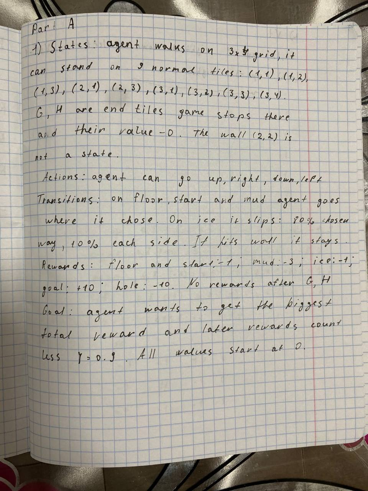

# HW6 submission

## AI-use declaration

I used Claude (an AI assistant) to explain the value iteration method and the Part A rules, and to check my Part A calculations. I wrote the Part A calculations by hand myself. Claude also designed the fixed policy table with me and wrote the Part B code (`part_b.py`), ran it, and produced the files in `outputs/`.

## Setup and reproduction

Versions used (my Windows machine): Python 3.12.2, gymnasium 1.4.0, numpy 2.5.5 (full list in `requirements.txt`, also saved in `outputs/versions.txt`). The same code also gave identical results with Python 3.10.12 and numpy 2.2.6, so the results do not depend on these versions.

Install and run Part B (from the repository folder):

```
python -m venv .venv
.venv\Scripts\activate        (Linux/macOS: source .venv/bin/activate)
pip install -r requirements.txt
python part_b.py
```

`part_b.py` runs all four conditions with fixed seeds, so running it again gives exactly the same files in `outputs/`. Part C commands will be added below when Part C is done.

## Part A — Paper calculations

Scan/photos of my hand calculations (description, V1, V2, arrows):




**V1 values (V0 = 0, gamma = 0.9; G and H are terminal, value 0):**

| | col 1 | col 2 | col 3 | col 4 |
| --- | --- | --- | --- | --- |
| row 1 | -1 | -1 | 10 | G (0) |
| row 2 | -1 | wall | -1 | H (0) |
| row 3 | -1 | -1 | -1 | -1 |

On the ice tile (2,3) the four actions give up -1.9, right -8.2, down -1.9, left -1.0, so V1(2,3) = -1 (best: left).

**V2 (using only V1):**

- (1,2): up -3.9, right 8, down -3.9, left -1.9, so V2 = 8
- (1,3): up 8, right 10, down -1.9, left -3.9, so V2 = 10
- (2,3), ice: up 5.21, right -7.39, down -2.71, left -0.91, so V2 = 5.21

**Best actions:** (1,2) right, (1,3) right, (2,3) up. There are no ties at these three tiles.

**Why two rounds are not enough:** Two rounds only look two moves ahead, so V2 is not the final value for the whole game. Far tiles like (3,1) still have V = -1 with many tied actions, because the reward of G has not reached them yet. Their values and best actions can change in later rounds, so the values must be updated until they stop changing before we can trust the policy.

## Part B — FrozenLake

### Fixed policy, written before the experiments

FrozenLake 4x4 states are numbered 0..15 by rows; holes are 5, 7, 11, 12 and the goal is 15. Actions: 0 = left, 1 = down, 2 = right, 3 = up.

| State | Action |
| --- | --- |
| 0 | right (2) |
| 1 | right (2) |
| 2 | down (1) |
| 3 | left (0) |
| 4 | down (1) |
| 6 | down (1) |
| 8 | right (2) |
| 9 | right (2) |
| 10 | down (1) |
| 13 | right (2) |
| 14 | right (2) |

Reasoning: I traced a safe path from the start to the goal on the non-slippery map: 0 -> 1 -> 2 -> 6 -> 10 -> 14 -> 15. For the other states I chose a move that goes back to this path or toward the goal and never goes directly into a hole (for example, state 3 goes left because down would be hole 7, and state 8 goes right because down would be hole 12). The policy is fixed and does not change between experiments. With slipping it should fail more often, because some tiles (like 10) have a hole next to them.

### Results

| Slippery? | Policy | Batch seed | Goals /50 | Holes /50 | Time limits /50 | Success % | Mean steps |
| --- | --- | --- | --- | --- | --- | --- | --- |
| False | random | 11 | 0 | 50 | 0 | 0.0 | 7.98 |
| False | random | 22 | 0 | 50 | 0 | 0.0 | 6.42 |
| False | random | 33 | 1 | 49 | 0 | 2.0 | 6.66 |
| False | fixed | 11 | 50 | 0 | 0 | 100.0 | 6.0 |
| False | fixed | 22 | 50 | 0 | 0 | 100.0 | 6.0 |
| False | fixed | 33 | 50 | 0 | 0 | 100.0 | 6.0 |
| True | random | 11 | 0 | 50 | 0 | 0.0 | 8.3 |
| True | random | 22 | 2 | 48 | 0 | 4.0 | 7.76 |
| True | random | 33 | 0 | 50 | 0 | 0.0 | 6.74 |
| True | fixed | 11 | 6 | 44 | 0 | 12.0 | 5.14 |
| True | fixed | 22 | 1 | 49 | 0 | 2.0 | 4.12 |
| True | fixed | 33 | 2 | 48 | 0 | 4.0 | 4.96 |

Files in `outputs/`:

- [episodes.csv](outputs/episodes.csv): one row per episode (600 rows): condition, batch seed, episode seed, policy, steps, total reward, outcome
- [batch_summary.csv](outputs/batch_summary.csv): the table above
- [example_episode.txt](outputs/example_episode.txt): one episode rendered as text (fixed policy, no slipping, seed 11000)
- [example_traces.txt](outputs/example_traces.txt): one successful and one failed trace
- [versions.txt](outputs/versions.txt): library versions

Example traces (fixed policy, slippery, state numbers 0..15; the arrow shows the chosen action and the next state):

```
Successful trace (fixed_slippery=True, batch seed 11, episode seed 11000, outcome goal, 11 steps):
0 -right-> 0 -right-> 4 -down-> 4 -down-> 4 -down-> 8 -right-> 9 -right-> 13 -right-> 9 -right-> 13 -right-> 14 -right-> 15

Failed trace (fixed_slippery=True, batch seed 11, episode seed 11001, outcome hole, 3 steps):
0 -right-> 1 -right-> 1 -right-> 5
```

**What slipping changed.** Without slipping the fixed policy reached the goal in all 150 episodes (100%) and always needed exactly 6 steps, because everything is deterministic. With slipping it reached the goal only 9 times out of 150 (6%), and most episodes ended in a hole. The random policy was bad in both cases: 1 goal out of 150 without slipping and 2 out of 150 with slipping. Mean steps with slipping are smaller for the fixed policy (4-5 instead of 6) because many episodes end early in a hole.

**Variation across batches.** Without slipping the fixed policy gave the same result in all three batches (100%), since nothing is random. With slipping the success rate changed a lot between batches (12%, 2%, 4%), and the random policy also jumped between 0% and 4%. So with randomness one batch of 50 episodes is not very stable.

**Why one success is weak evidence.** A single success can be just luck: even the random policy reached the goal 3 times in 300 episodes. To say a policy is good we need many episodes and several batches with different seeds, and we should look at the success rate, not one run. The outcome "time limit" never happened in these runs: every episode ended in the goal or in a hole before 100 steps.

**Why these runs do not train a policy.** The fixed policy was written before the experiments and never changes. The simulations only measure (evaluate) how good a given policy is. Nothing is updated between episodes, so running more episodes does not make the agent better.


## Part C — Custom solver

### Compare code with paper

Show V1 and the requested V2 values. Explain discrepancies.

### Values, policies and convergence

Link both value/policy maps. Record iteration counts, final value changes and tie-breaking rule.

### Simulation results

| Map | Batch seed | Goals /50 | Holes /50 | Time limits /50 | Mean steps | Mean discounted return |
| --- | --- | --- | --- | --- | --- | --- |

### Explain your results

Which values/actions changed with sand and water? Where did cost and risk matter? How do simulations relate to the computed values?

### Rule checks

Show boundary/wall behavior, slip probabilities, floor rewards and terminal handling.

