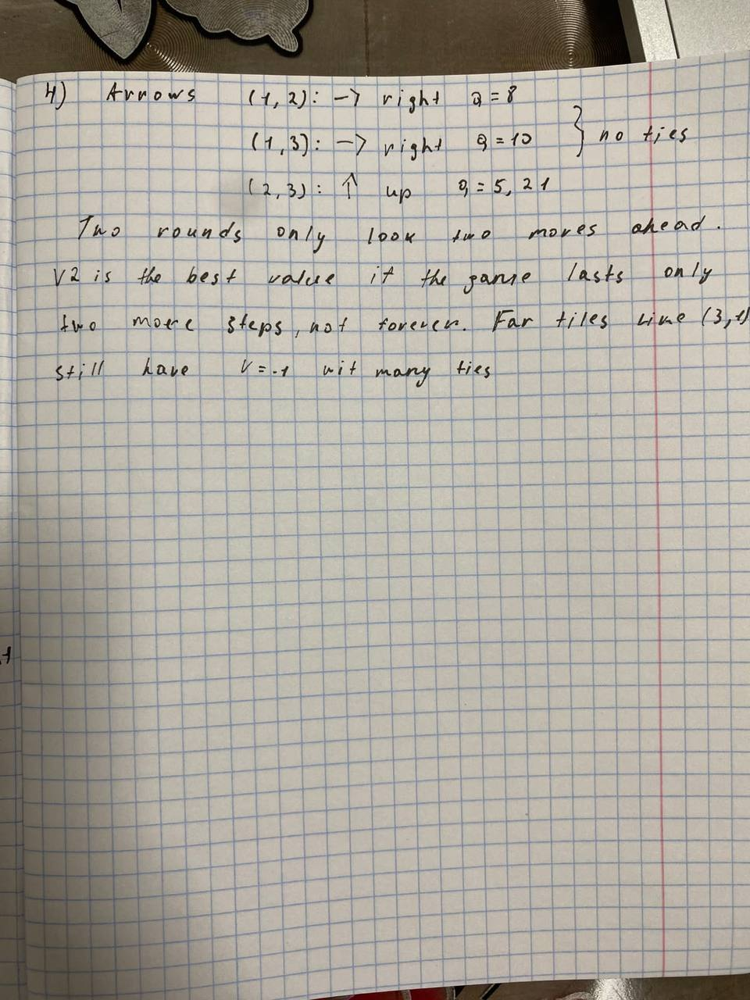

# HW6 submission

## AI-use declaration

I used Claude (an AI assistant) to explain the value iteration method and the Part A rules, and to check my Part A calculations. I wrote the Part A calculations by hand myself.

## Setup and reproduction

Record dependency versions, installation commands and exact run commands.

## Part A — Paper calculations

Scan/photos of my hand calculations (description, V1, V2, arrows):

**V1 values (V0 = 0, gamma = 0.9; G and H are terminal, value 0):**

| | col 1 | col 2 | col 3 | col 4 |
| --- | --- | --- | --- | --- |
| row 1 | -1 | -1 | 10 | G (0) |
| row 2 | -1 | wall | -1 | H (0) |
| row 3 | -1 | -1 | -1 | -1 |

On the ice tile (2,3) the four actions give up -1.9, right -8.2, down -1.9, left -1.0, so V1(2,3) = -1 (best: left).

**V2 (using only V1):**

- (1,2): up -3.9, right 8, down -3.9, left -1.9, so V2 = 8
- (1,3): up 8, right 10, down -1.9, left -3.9, so V2 = 10
- (2,3), ice: up 5.21, right -7.39, down -2.71, left -0.91, so V2 = 5.21

**Best actions:** (1,2) right, (1,3) right, (2,3) up. There are no ties at these three tiles.

**Why two rounds are not enough:** Two rounds only look two moves ahead, so V2 is not the final value for the whole game. Far tiles like (3,1) still have V = -1 with many tied actions, because the reward of G has not reached them yet. Their values and best actions can change in later rounds, so the values must be updated until they stop changing before we can trust the policy.

## Part B — FrozenLake

### Fixed policy, written before the experiments

State the action for each nonterminal state and your reasoning.

### Results

| Slippery? | Policy | Batch seed | Goals /50 | Holes /50 | Time limits /50 | Success % | Mean steps |
| --- | --- | --- | --- | --- | --- | --- | --- |

Link episode rows and example traces in outputs/. Explain slipping, variation across batches and why these runs do not train a policy.

## Part C — Custom solver

### Compare code with paper

Show V1 and the requested V2 values. Explain discrepancies.

### Values, policies and convergence

Link both value/policy maps. Record iteration counts, final value changes and tie-breaking rule.

### Simulation results

| Map | Batch seed | Goals /50 | Holes /50 | Time limits /50 | Mean steps | Mean discounted return |
| --- | --- | --- | --- | --- | --- | --- |

### Explain your results

Which values/actions changed with sand and water? Where did cost and risk matter? How do simulations relate to the computed values?

### Rule checks

Show boundary/wall behavior, slip probabilities, floor rewards and terminal handling.

