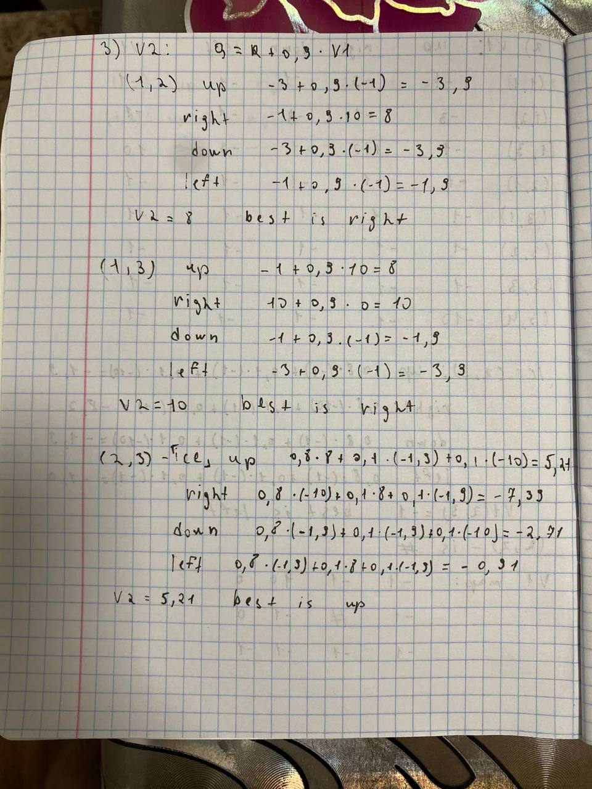

# HW6 submission

## AI-use declaration

I used Claude (an AI assistant) to explain the value iteration method and the Part A rules, and to check my Part A calculations. I wrote the Part A calculations by hand myself. Claude also designed the fixed policy table with me and wrote the Part B and Part C code (`part_b.py`, `gridmdp.py`, `solver.py`, `simulate.py`, `part_c.py`, `checks.py`), ran it, and produced the files in `outputs/`. I compared the Part C results with my own paper work.

## Setup and reproduction

Versions used (my Windows machine): Python 3.12.2, gymnasium 1.4.0, numpy 2.5.5 (full list in `requirements.txt`, also saved in `outputs/versions.txt`). The same code also gave identical results with Python 3.10.12 and numpy 2.2.6, so the results do not depend on these versions.

Install and run Part B (from the repository folder):

```
python -m venv .venv
.venv\Scripts\activate        (Linux/macOS: source .venv/bin/activate)
pip install -r requirements.txt
python part_b.py
```

`part_b.py` runs all four conditions with fixed seeds, so running it again gives exactly the same files in `outputs/`.

Run Part C (needs only numpy; the floor rules and both maps are read from `data/maps.json`):

```
python part_c.py     # solver, policies, simulations, comparison -> outputs/part_c_*
python checks.py     # rule checks -> outputs/rule_checks.txt
```

Both scripts use fixed seeds and give identical files when run again.

## Part A — Paper calculations

Scan/photos of my hand calculations (description, V1, V2, arrows):





**V1 values (V0 = 0, gamma = 0.9; G and H are terminal, value 0):**

| | col 1 | col 2 | col 3 | col 4 |
| --- | --- | --- | --- | --- |
| row 1 | -1 | -1 | 10 | G (0) |
| row 2 | -1 | wall | -1 | H (0) |
| row 3 | -1 | -1 | -1 | -1 |

On the ice tile (2,3) the four actions give up -1.9, right -8.2, down -1.9, left -1.0, so V1(2,3) = -1 (best: left).

**V2 (using only V1):**

- (1,2): up -3.9, right 8, down -3.9, left -1.9, so V2 = 8
- (1,3): up 8, right 10, down -1.9, left -3.9, so V2 = 10
- (2,3), ice: up 5.21, right -7.39, down -2.71, left -0.91, so V2 = 5.21

**Best actions:** (1,2) right, (1,3) right, (2,3) up. There are no ties at these three tiles.

**Why two rounds are not enough:** Two rounds only look two moves ahead, so V2 is not the final value for the whole game. Far tiles like (3,1) still have V = -1 with many tied actions, because the reward of G has not reached them yet. Their values and best actions can change in later rounds, so the values must be updated until they stop changing before we can trust the policy.

## Part B — FrozenLake

### Fixed policy, written before the experiments

FrozenLake 4x4 states are numbered 0..15 by rows; holes are 5, 7, 11, 12 and the goal is 15. Actions: 0 = left, 1 = down, 2 = right, 3 = up.

| State | Action |
| --- | --- |
| 0 | right (2) |
| 1 | right (2) |
| 2 | down (1) |
| 3 | left (0) |
| 4 | down (1) |
| 6 | down (1) |
| 8 | right (2) |
| 9 | right (2) |
| 10 | down (1) |
| 13 | right (2) |
| 14 | right (2) |

Reasoning: I traced a safe path from the start to the goal on the non-slippery map: 0 -> 1 -> 2 -> 6 -> 10 -> 14 -> 15. For the other states I chose a move that goes back to this path or toward the goal and never goes directly into a hole (for example, state 3 goes left because down would be hole 7, and state 8 goes right because down would be hole 12). The policy is fixed and does not change between experiments. With slipping it should fail more often, because some tiles (like 10) have a hole next to them.

### Results

| Slippery? | Policy | Batch seed | Goals /50 | Holes /50 | Time limits /50 | Success % | Mean steps |
| --- | --- | --- | --- | --- | --- | --- | --- |
| False | random | 11 | 0 | 50 | 0 | 0.0 | 7.98 |
| False | random | 22 | 0 | 50 | 0 | 0.0 | 6.42 |
| False | random | 33 | 1 | 49 | 0 | 2.0 | 6.66 |
| False | fixed | 11 | 50 | 0 | 0 | 100.0 | 6.0 |
| False | fixed | 22 | 50 | 0 | 0 | 100.0 | 6.0 |
| False | fixed | 33 | 50 | 0 | 0 | 100.0 | 6.0 |
| True | random | 11 | 0 | 50 | 0 | 0.0 | 8.3 |
| True | random | 22 | 2 | 48 | 0 | 4.0 | 7.76 |
| True | random | 33 | 0 | 50 | 0 | 0.0 | 6.74 |
| True | fixed | 11 | 6 | 44 | 0 | 12.0 | 5.14 |
| True | fixed | 22 | 1 | 49 | 0 | 2.0 | 4.12 |
| True | fixed | 33 | 2 | 48 | 0 | 4.0 | 4.96 |

Files in `outputs/`:

- [episodes.csv](outputs/episodes.csv): one row per episode (600 rows): condition, batch seed, episode seed, policy, steps, total reward, outcome
- [batch_summary.csv](outputs/batch_summary.csv): the table above
- [example_episode.txt](outputs/example_episode.txt): one episode rendered as text (fixed policy, no slipping, seed 11000)
- [example_traces.txt](outputs/example_traces.txt): one successful and one failed trace
- [versions.txt](outputs/versions.txt): library versions

Example traces (fixed policy, slippery, state numbers 0..15; the arrow shows the chosen action and the next state):

```
Successful trace (fixed_slippery=True, batch seed 11, episode seed 11000, outcome goal, 11 steps):
0 -right-> 0 -right-> 4 -down-> 4 -down-> 4 -down-> 8 -right-> 9 -right-> 13 -right-> 9 -right-> 13 -right-> 14 -right-> 15

Failed trace (fixed_slippery=True, batch seed 11, episode seed 11001, outcome hole, 3 steps):
0 -right-> 1 -right-> 1 -right-> 5
```

**What slipping changed.** Without slipping the fixed policy reached the goal in all 150 episodes (100%) and always needed exactly 6 steps, because everything is deterministic. With slipping it reached the goal only 9 times out of 150 (6%), and most episodes ended in a hole. The random policy was bad in both cases: 1 goal out of 150 without slipping and 2 out of 150 with slipping. Mean steps with slipping are smaller for the fixed policy (4-5 instead of 6) because many episodes end early in a hole.

**Variation across batches.** Without slipping the fixed policy gave the same result in all three batches (100%), since nothing is random. With slipping the success rate changed a lot between batches (12%, 2%, 4%), and the random policy also jumped between 0% and 4%. So with randomness one batch of 50 episodes is not very stable.

**Why one success is weak evidence.** A single success can be just luck: even the random policy reached the goal 3 times in 300 episodes. To say a policy is good we need many episodes and several batches with different seeds, and we should look at the success rate, not one run. The outcome "time limit" never happened in these runs: every episode ended in the goal or in a hole before 100 steps.

**Why these runs do not train a policy.** The fixed policy was written before the experiments and never changes. The simulations only measure (evaluate) how good a given policy is. Nothing is updated between episodes, so running more episodes does not make the agent better.


## Part C — Custom solver

### Compare code with paper

My solver (`solver.py`, value iteration written from scratch; the model is in `gridmdp.py`) prints the following for the paper map (full output: [part_c_vs_paper.txt](outputs/part_c_vs_paper.txt)).

V1 (every nonterminal tile):

```
row 1:     -1.000    -1.000    10.000   G=0.000
row 2:     -1.000         #    -1.000   H=0.000
row 3:     -1.000    -1.000    -1.000    -1.000
```

V2 at the three requested tiles, using only V1 (all four actions):

| Tile | up | right | down | left | V2 |
| --- | --- | --- | --- | --- | --- |
| (1,2) | -3.9 | 8 | -3.9 | -1.9 | 8 |
| (1,3) | 8 | 10 | -1.9 | -3.9 | 10 |
| (2,3) ice | 5.21 | -7.39 | -2.71 | -0.91 | 5.21 |

**Discrepancies: none.** The program compares itself with the numbers from my paper work and every one matches: all 9 values of V1, the four V1 actions on the ice tile (-1.9, -8.2, -1.9, -1.0), and the 12 action values and 3 values of V2 above (each line says `OK` in `part_c_vs_paper.txt`). So I did not have to correct my paper calculations.

### Values, policies and convergence

Stopping rule: stop when the largest absolute change in a full update is below 0.000001 (safeguard: 10,000 iterations). Both maps converged long before the safeguard.

| Map | Iterations | Final largest change | Converged? |
| --- | --- | --- | --- |
| paper map | 12 | 2.165e-07 | yes |
| extended map | 11 | 2.406e-07 | yes |

As an extra check I measured the Bellman residual of the final values (how far V* is from satisfying the Bellman equation); it was 1.95e-08 on the paper map and 2.17e-08 on the extended map.

Full printouts (value map, policy arrows, tied actions, Q-values): [paper map](outputs/part_c_values_paper_map.txt), [extended map](outputs/part_c_values_extended_map.txt).

**Paper map**, final values V* and policy:

```
row 1:      4.200     8.000    10.000   G=0.000
row 2:      2.780         #     5.824   H=0.000
row 3:      1.536     2.818     4.242     2.818

row 1:    →   →   →   G
row 2:    ↑   #   ↑   H
row 3:    →   →   ↑   ←
```

**Extended map** (`.M.G / .#IH / SD.W`), final values V* and policy:

```
row 1:      4.200     8.000    10.000   G=0.000
row 2:      2.780         #     5.824   H=0.000
row 3:      1.502     2.818     4.242     2.818

row 1:    →   →   →   G
row 2:    ↑   #   ↑   H
row 3:    ↑   →   ↑   ←
```

**Tie-breaking rule:** the policy compares the Q-value of all four actions using the final values. An action counts as tied with the best one if its Q-value is within 1e-9 of the maximum, and among tied actions I choose the first one in the order up, right, down, left. With the final values no tile had a tie on either map, so the rule did not change any action here (the V1 round had many ties, see Part A).

### Simulation results

| Map | Batch seed | Goals /50 | Holes /50 | Time limits /50 | Mean steps | Mean discounted return |
| --- | --- | --- | --- | --- | --- | --- |
| paper | 11 | 47 | 3 | 0 | 5.04 | 2.2297 |
| paper | 22 | 44 | 6 | 0 | 4.96 | 1.4424 |
| paper | 33 | 42 | 8 | 0 | 4.88 | 0.97 |
| extended | 11 | 50 | 0 | 0 | 5.0 | 1.502 |
| extended | 22 | 50 | 0 | 0 | 5.0 | 1.502 |
| extended | 33 | 50 | 0 | 0 | 5.0 | 1.502 |

Overall (150 episodes per map):
- paper: mean discounted return 1.5474 vs V*(start) = 1.5358; episodes that stepped on the ice tile: 150; episodes ending in the hole: 17 (of these 17 had visited the ice tile)
- extended: mean discounted return 1.5020 vs V*(start) = 1.5020; episodes that stepped on the ice tile: 0; episodes ending in the hole: 0 (of these 0 had visited the ice tile)

Episode rows with the path of every episode: [part_c_episodes.csv](outputs/part_c_episodes.csv); summary: [part_c_simulation_summary.csv](outputs/part_c_simulation_summary.csv). The simulator is my own (`simulate.py`): it uses the computed policy, the Part B seed scheme (episode seed = 1000 x batch seed + i), a 100-step limit, and the return r0 + 0.9 r1 + 0.9^2 r2 + ...

### Explain your results

**What changed with sand and water.** Only one tile changed: the start tile (3,1). Its value dropped from 1.536 to 1.502 and its best action changed from right to up. All other values and actions are the same (the tiny differences in [part_c_comparison.txt](outputs/part_c_comparison.txt) are at most 2.2e-8, which is just the stopping tolerance). The reason: on the paper map the best route from the start goes right along the bottom row, then up through the ice tile: (3,1) -> (3,2) -> (3,3) -> (2,3) -> (1,3) -> G. On the extended map (3,2) is sand (-2 instead of -1), so moving right from the start is worth only 0.536, while moving up is worth 1.502. The policy therefore takes the other route, up the left column and through the mud: (3,1) -> (2,1) -> (1,1) -> (1,2) -> (1,3) -> G. The water tile (3,4) is never used: entering it from (3,3) is worth -2.46, while moving up from (3,3) is worth 4.24, and nothing in the policy leads to (3,4) from the start.

**Where floor costs mattered.** Only at the start tile, and the decision was close: on the paper map the ice route is better than the safe mud route by just 0.034 (1.536 against 1.502). The extra sand cost of 1 is enough to flip it. Mud (-3) was accepted by the policy on the left route because the move is deterministic and the mud is a one-time cost.

**Cost and risk.** On the paper map the policy accepts a risk. It steps on the ice tile in all 150 episodes. At the ice tile the action up is chosen: the wall on the left means a left slip only keeps the agent on the ice (reward -1, try again), and only the right slip (10%) falls into the hole. The probability of falling is 0.1 / (0.1 + 0.8) = 1/9, about 11.1%, and the simulation gave 17 holes in 150 episodes (11.3%). The action left would never fall into the hole, but it is slow (value 4.475 against 5.824), and right is terrible (-6.918, because 80% goes into the hole). On the extended map the policy avoids the ice completely and the simulation had 0 holes in 150 episodes: the sand made the risky route less attractive than the safe one.

**How simulations relate to the computed values.** V* is an expected value over infinitely many possible runs, so it is not the same as the average of a finite simulation; a finite simulation is only an estimate of it. On the paper map the mean discounted return over 150 episodes was 1.5474 against V*(start) = 1.5358, and the three batches differ a lot (2.23, 1.44 and 0.97) because a goal gives about +3.1 but a fall into the hole gives -10, and the number of falls differs between batches (3, 6 and 8). The difference to V* is sampling noise. The 100-step limit cuts off the sum after 100 steps; this would change the value by at most 0.9^100 x 10 / (1 - 0.9), about 0.003, and here it did not matter at all because every episode ended within 6 steps (no time limits). On the extended map every episode follows the same deterministic path, so the return of each episode is exactly 1.502, equal to V*(start); this is a special case, since there is no randomness left on that route.

### Rule checks

All 25 checks passed (`python checks.py`; full output with the exact transitions: [rule_checks.txt](outputs/rule_checks.txt)). I ran them for both maps before trusting the solver. Short summary:

- **Wall and boundary behavior.** A blocked move keeps the agent in place and gives the reward of the tile where the move ends. Examples: from (2,1) moving right into the wall gives stay on (2,1) with reward -1; from the mud tile (1,2) moving down into the wall stays on (1,2) with reward -3; from (1,1) moving up (map edge) stays with reward -1; on the extended map from the water tile (3,4) moving down stays with reward -5.
- **Slip probabilities.** On the ice tile (2,3) the probabilities of each of the four actions sum to 1. For up the outcomes are 0.8 to (1,3), 0.1 stay on the ice (the left slip hits the wall) and 0.1 into the hole; for left they are 0.8 stay (wall), 0.1 to (1,3) and 0.1 to (3,3); for right they are 0.8 into the hole, 0.1 to (1,3) and 0.1 to (3,3). All other tiles, including sand and water, have exactly one outcome with probability 1.
- **Floor rewards.** Entering floor or start gives -1, ice -1, mud -3, sand -2, water -5, the goal +10 and the hole -10.
- **Terminal handling.** G and H have no transitions, their value stays 0 in every round, and in 50 simulated episodes on each map no move and no reward happened after the first terminal tile (each episode has exactly one reward per move and ends on G or H or at the step limit).

